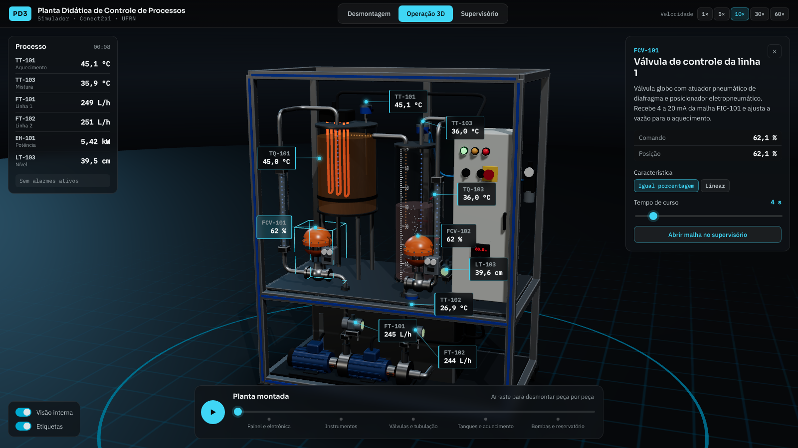

# Planta Didática PD3 · Simulador

Simulador web de uma planta didática de controle de processos com dois tanques: aquecimento e mistura. Roda direto no navegador, sem instalação, e pode ser publicado no GitHub Pages.

Endereço da página `https://conect2ai.github.io/planta-pd3/`



## O que dá para fazer

**Desmontagem.** A planta se separa em cinco etapas: painel e eletrônica, instrumentos, válvulas e tubulação, tanques e aquecimento, bombas e reservatório. Arraste a barra inferior ou use o botão de reprodução. Clique em qualquer peça para abrir o inspetor.

**Operação 3D.** A planta funciona em tempo real. Os rotâmetros acompanham a vazão, as válvulas mudam de curso, as resistências brilham conforme a potência e a água muda de cor com a temperatura. No inspetor você ajusta cada componente, por exemplo.

| Componente | Parâmetros |
|---|---|
| Bombas P-101 e P-102 | liga e desliga, vazão máxima, frequência do inversor |
| Válvulas FCV-101 e FCV-102 | característica igual porcentagem ou linear, tempo de curso |
| Transmissores | ruído, atraso, erro de calibração, sinal congelado |
| Resistências | potência máxima, intertravamento por vazão, temperatura de desarme |
| Tanque de mistura | saídas a 10, 25 e 38 cm, agitação por ar |

**Supervisório.** Tela no estilo ISA-101, com cinza neutro e cor reservada para condição anormal. Tem sinóptico clicável, faceplates das quatro malhas, sintonia (Kc, Ti, Td), modos MAN, AUTO e CAS, tendência, lista de alarmes e cenários prontos.

## Estratégias de controle

| Malha | Variável | Atua em | Observação |
|---|---|---|---|
| FIC-101 | vazão da linha 1 | FCV-101 | malha rápida |
| FIC-102 | vazão da linha 2 | FCV-102 | escrava da cascata (modo CAS) |
| TIC-101 | temperatura do aquecimento | módulo a tiristor | realimentação com antecipativo pela vazão e pela temperatura da água fria |
| TIC-103 | temperatura da mistura | setpoint da FIC-102 | mestre da cascata, ação direta |

Cenários incluídos
- degrau no setpoint da mistura
- perturbação no inversor com a cascata ativa e com ela desfeita
- degrau de vazão com e sem o antecipativo
- falha de bomba
- sensor congelado

## Modelo

O modelo resolve balanços de massa e energia com passo de 0,1 s.

- **Tanque de aquecimento.** Sempre cheio, com volume de 27 L.
  `ρc·V·dT1/dt = ρc·F1·(T2 − T1) + P − UA·(T1 − Tamb)`
- **Tanque de mistura.** O nível vem do balanço entre a entrada e as saídas por orifício, `F = k·√(h − hi)`. A temperatura é a mistura das duas correntes.
- **Instrumentos.** Os transmissores têm atraso de primeira ordem e ruído. As válvulas têm tempo de curso finito.
- **Intertravamentos.**
  - as resistências desligam com vazão abaixo do mínimo;
  - também desligam acima da temperatura de desarme;
  - a parada de emergência desliga tudo.

As ordens de grandeza seguem ensaios publicados em plantas desse tipo, com cerca de 2 a 4 °C/kW e constante de tempo de alguns minutos no aquecimento. Os tags e demais parâmetros são ilustrativos.

## Publicar no GitHub Pages

```bash
git init
git add .
git commit -m "Simulador da planta didática PD3"
git branch -M main
git remote add origin https://github.com/conect2ai/planta-pd3.git
git push -u origin main
```

Depois, no repositório, vá em **Settings → Pages**, escolha **Deploy from a branch**, branch `main`, pasta `/ (root)`. A página fica disponível em alguns minutos.

Para rodar localmente, sirva a pasta com qualquer servidor estático, por exemplo `python3 -m http.server`, e abra `http://localhost:8000`.

## Estrutura

```
index.html          interface
css/app.css         estilos da cena e do supervisório
js/process.js       modelo de processo, PID, alarmes
js/plant3d.js       cena 3D, desmontagem, fluxos
js/components.js    descrição e parâmetros de cada componente
js/hmi.js           supervisório ISA-101
js/main.js          orquestração e modo de captura
vendor/three        Three.js r160
```

Para gerar animações quadro a quadro, abra `index.html#gif=teardown` ou `index.html#gif=hmi`, que expõem `window.__frame(dt)`.

---
Conect2ai · DCA · UFRN
